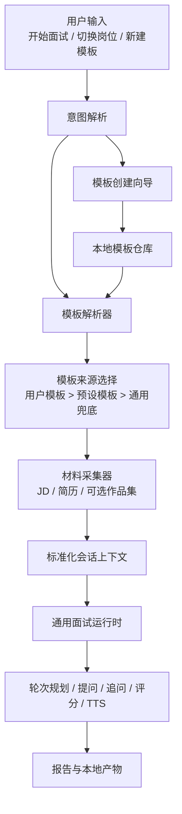

# 通用面试 Skill 改造方案

## 1. 背景

当前 `android-interview` 已具备较完整的面试运行时能力：

- 具备 `intake -> JD/简历分析 -> 轮次规划 -> 提问 -> 追问 -> 评分 -> 报告` 主链路
- 已支持 question bank、TTS、persona、speech overrides、批处理与交互式运行
- AI 与确定性 fallback 已有边界

当前主要限制不在运行时能力，而在“岗位模型”和“用户入口”：

- Android 领域假设深度写死在 skill 文案和部分 Python runtime 中
- 缺少岗位模板层，无法低成本切换到后端、产品、测试、设计等岗位
- 缺少自然语言模板创建入口
- 缺少面试开始前的材料采集对话，JD / 简历更多依赖用户预先准备

本方案目标是在保留现有主链路与兼容性的前提下，将其逐步演进为更通用的面试 skill。

## 2. 目标

### 2.1 核心目标

1. 将当前 skill 抽象为“通用面试运行时 + 岗位模板 / 预设层”。
2. 支持通过简单配置快速切换岗位。
3. 支持通过自然语言创建用户自定义模板，并保存到本地复用。
4. 在面试开始前，通过对话收集 JD 和简历地址或正文内容。
5. 当同岗位同时存在预设模板与用户模板时，优先使用用户模板。
6. 保持现有 Android 场景可继续正常使用，作为第一个正式 preset。

### 2.2 非目标

1. 首期不追求所有行业的一次性全覆盖。
2. 首期不要求把所有问题生成逻辑都交给自由生成式 AI。
3. 首期不改造成完全无结构的自然语言驱动运行时。
4. 首期不移除现有 `android-interview` skill 名称与入口。

## 3. 设计原则

### 3.1 兼容优先

- 保留当前 `android-interview` 目录和现有 CLI 入口。
- 将 Android 视为首个预设模板，而不是特殊硬编码流程。

### 3.2 配置驱动

- 将“岗位差异”从 Python 逻辑中抽到模板配置。
- 运行时只消费结构化 profile，不直接依赖岗位名字符串分支。

### 3.3 用户模板优先

- 预设模板用于开箱即用。
- 用户模板用于贴合个人面试习惯和岗位语境。
- 同名或同角色冲突时，用户模板优先级高于预设模板。

### 3.4 自然语言先解析、后执行

- 自然语言只用于解析意图和补齐配置。
- 真正驱动运行时的是标准化后的模板与会话上下文。

### 3.5 材料与模板解耦

- 模板描述“岗位与面试策略”。
- JD / 简历 / 作品集描述“本次会话材料”。
- 两者必须分层，避免一个模板绑定一次性材料。

## 4. 目标架构



## 5. 分层方案

### 5.1 运行时核心层

职责：

- intake 状态管理
- 轮次规划
- 题目选择与 fallback 生成
- 追问决策
- 评分与 round deliberation
- TTS / persona / speech overrides
- 报告渲染

这一层尽量不感知具体岗位名称，只消费标准化 profile。

### 5.2 预设模板层

职责：

- 提供 Android、后端、产品等岗位的默认能力模型
- 定义默认轮次、重点能力、JD 信号词、简历风险点、intro 话术
- 定义不同岗位默认的 persona / TTS / question strategy

### 5.3 用户模板层

职责：

- 保存用户自定义岗位模板
- 支持继承预设模板并覆写局部字段
- 支持通过自然语言创建和后续修改

### 5.4 模板解析与材料采集层

职责：

- 把自然语言映射到标准 template/profile
- 收集当前会话材料
- 在面试开始前补齐缺失字段

## 6. 模板类型

建议分三类：

1. `preset`
   - 仓库内置模板
   - 例如 `android_senior`、`backend_senior`、`product_manager_senior`

2. `user`
   - 用户本地创建模板
   - 可覆盖内置模板的默认配置

3. `session_override`
   - 当前会话临时覆写
   - 不落盘，优先级高于已加载模板但低于显式用户指令

优先级建议：

`session override > user template > preset template > generic fallback`

其中在“模板选择”阶段，默认理解为：

`user template > preset template > generic fallback`

## 7. 模板数据模型

建议使用 YAML，便于人工阅读和 diff。首版可以兼容 JSON 读取。

### 7.1 顶层字段

| 字段 | 必填 | 说明 |
| --- | --- | --- |
| `template_id` | 是 | 模板唯一 ID，机器可读，建议 snake_case |
| `display_name` | 是 | 展示给用户看的模板名 |
| `template_type` | 是 | `preset` / `user` |
| `version` | 是 | 模板版本，便于未来迁移 |
| `enabled` | 否 | 是否启用 |
| `aliases` | 否 | 自然语言匹配别名 |
| `inherits_from` | 否 | 继承的父模板 ID |
| `priority` | 否 | 同类匹配时排序权重 |
| `description` | 否 | 模板描述 |
| `target_role` | 是 | 目标岗位名称 |
| `role_family` | 是 | 岗位族，例如 `android`、`backend`、`pm` |
| `industry` | 否 | 默认行业语境 |
| `domain` | 否 | 细分领域，例如支付、推荐、音视频 |
| `candidate_level` | 是 | 默认目标级别 |
| `supported_levels` | 否 | 该模板支持的级别集合 |
| `company_stage` | 否 | 默认公司阶段，例如 startup、growth、enterprise |
| `default_language` | 否 | 默认面试语言 |
| `default_speech_language` | 否 | 默认播报语言 |
| `interview_mode` | 否 | 默认模式，如 `full`、`screening_only` |
| `rounds` | 是 | 轮次配置 |
| `competency_model` | 是 | 能力模型 |
| `screening_dimensions` | 否 | 初筛维度 |
| `question_strategy` | 否 | 选题与追问策略 |
| `intro_prompt` | 否 | 自我介绍题模板 |
| `jd_signal_lexicon` | 否 | JD 关键词和信号规则 |
| `resume_signal_lexicon` | 否 | 简历信号和风险词规则 |
| `report_labels` | 否 | 报告文案映射 |
| `persona_defaults` | 否 | 默认 interviewer persona |
| `tts_defaults` | 否 | TTS 默认配置 |
| `material_requirements` | 否 | 本次面试需要的材料类型 |
| `question_bank_rules` | 否 | 题库约束 |
| `scoring_policy` | 否 | 评分策略 |
| `agent_policy` | 否 | AI / fallback 策略 |
| `tags` | 否 | 标签，便于检索 |
| `owner` | 否 | 用户模板所有者标识 |
| `updated_at` | 否 | 最近更新时间 |

### 7.2 字段解释

#### `template_id`

- 稳定且唯一
- 例：`android_senior_cn`、`backend_tl_growth`

#### `aliases`

- 用于自然语言匹配
- 例：`["高级后端", "Java 后端", "服务端"]`

#### `inherits_from`

- 用于减少重复配置
- 例：用户模板 `my_backend_interview` 继承 `backend_senior`

#### `role_family`

- 代表问题模型和能力模型的大类
- 比如 Android 与 iOS 可以是不同 family，也可以同属 `mobile`

#### `candidate_level`

- 当前模板默认用于什么级别
- 不等于用户本次会话最终级别，后者可被会话覆盖

#### `material_requirements`

- 决定开场是否必须采集 JD、简历、作品集、GitHub、项目链接
- 用于控制 intake 的追问策略

## 8. 子结构设计

### 8.1 `rounds`

```yaml
rounds:
  - round_id: intro
    label:
      zh: 自我介绍
      en: Introduction
    enabled: true
    order: 10
    goal: 建立岗位相关度与最强项目锚点
    default_language: auto
    target_question_count: 1
    focuses:
      - role_alignment
      - communication
      - project_anchor
  - round_id: deep_dive
    label:
      zh: 核心深挖
      en: Deep Dive
    enabled: true
    order: 30
    goal: 深挖关键项目、权衡、复杂度与结果
    target_question_count: 3
    focuses:
      - architecture
      - execution_depth
      - tradeoff_reasoning
```

字段说明：

- `round_id`：轮次唯一标识
- `label`：多语言显示名称
- `enabled`：默认是否启用
- `order`：轮次顺序
- `goal`：本轮目标
- `default_language`：轮次默认语言
- `target_question_count`：预期问题数
- `focuses`：该轮重点能力点
- `persona`：可选，覆盖默认 persona
- `exit_policy`：本轮提前结束策略

### 8.2 `competency_model`

```yaml
competency_model:
  role_alignment:
    label:
      zh: 岗位匹配
      en: Role Alignment
    description: 是否具备岗位核心经验与相关案例
    required: true
  architecture:
    label:
      zh: 架构能力
      en: Architecture
    description: 能否解释方案设计、边界与权衡
    required: true
  business_understanding:
    label:
      zh: 业务理解
      en: Business Understanding
    description: 能否连接技术动作与业务结果
    required: false
```

字段说明：

- `label`：能力名称
- `description`：能力解释
- `required`：是否为必考核能力
- `weight`：可选，评分权重
- `round_preference`：建议在哪一轮验证
- `example_signals`：理想回答信号
- `risk_signals`：风险信号

### 8.3 `screening_dimensions`

```yaml
screening_dimensions:
  - name: role_alignment
    label:
      zh: 岗位匹配度
      en: Role Alignment
    source:
      - jd
      - resume
    threshold: 3.5
  - name: ownership
    label:
      zh: 个人职责边界
      en: Ownership
    source:
      - resume
      - interview
```

字段说明：

- `name`：维度 ID
- `label`：展示名
- `source`：证据来源
- `threshold`：预期阈值
- `fallback_prompt`：该维度证据不足时的追问提示

### 8.4 `question_strategy`

```yaml
question_strategy:
  primary_mode: evidence_first
  dynamic_generation_enabled: true
  prefer_question_bank: true
  follow_up_style: gap_driven
  fallback_question_mode: template_driven
```

字段说明：

- `primary_mode`：选题主模式
- `dynamic_generation_enabled`：是否允许动态生成问题
- `prefer_question_bank`：优先使用题库还是动态问题
- `follow_up_style`：追问策略
- `fallback_question_mode`：题库不足时的兜底方式

### 8.5 `persona_defaults`

```yaml
persona_defaults:
  default_persona: guided_mentor
  round_overrides:
    deep_dive: technical_deep_diver
    hr: leadership_evaluator
```

### 8.6 `tts_defaults`

```yaml
tts_defaults:
  enabled: true
  speech_language: auto
  voice: auto
  rate: "+0%"
  pitch: "+0Hz"
  volume: "+0%"
  persona_voice_map:
    guided_mentor:
      zh: zh-CN-XiaoxiaoNeural
      en: en-US-JennyNeural
    technical_deep_diver:
      zh: zh-CN-YunxiNeural
      en: en-US-EricNeural
```

### 8.7 `material_requirements`

```yaml
material_requirements:
  require_jd: true
  require_resume: true
  optional_inputs:
    - portfolio_url
    - github_url
    - project_doc
  allow_inline_text: true
  allow_file_path: true
  allow_url: true
```

这一层会直接驱动开场采集对话。

## 9. 自然语言创建模板能力

## 9.1 结论

可以支持，而且非常适合作为通用化改造的一部分。

建议实现为：

`自然语言意图 -> 模板创建向导 -> 必要字段补齐 -> 预览确认 -> 保存到本地`

而不是让模型一次性自由生成完整模板直接落盘。

## 9.2 用户触发方式

典型表达：

- “帮我新建一个岗位模板”
- “创建一个高级后端面试模板”
- “我想保存一套产品经理面试配置”
- “把当前这套设置存成模板”

## 9.3 创建流程

建议状态机：

```text
template_create_intent
-> collect_base_info
-> collect_rounds_and_competencies
-> collect_language_and_tts
-> collect_material_requirements
-> preview_template
-> confirm_save
-> persist_template
-> completed
```

## 9.4 必填采集项

首版建议只要求：

- `display_name`
- `target_role`
- `role_family`
- `candidate_level`
- `default_language`
- `rounds`
- `competency_model`

## 9.5 推荐采集项

- `industry`
- `domain`
- `company_stage`
- `question_strategy`
- `persona_defaults`
- `tts_defaults`
- `material_requirements`

## 9.6 问答策略

原则：

- 每一步只问当前最关键的 1 到 3 个缺失字段
- 先收高价值字段，再收细节
- 支持用户说“先用默认值”
- 对已有预设可建议“从某个预设继承”

示例流程：

1. 用户：帮我新建一个岗位模板
2. 助手：这个模板主要面向什么岗位？
3. 用户：高级后端
4. 助手：偏哪种方向，Java 服务端、Go 服务端，还是通用后端？
5. 用户：Java 服务端
6. 助手：默认用中文、英文，还是双语面试？
7. 用户：中文
8. 助手：是否要求先提供 JD 和简历？
9. 用户：都需要
10. 助手：我先按“高级 Java 后端中文面试模板”生成预览，请确认是否保存

## 10. 本地存储与优先级

### 10.1 建议目录

```text
skills/android-interview/
├── data/
│   ├── presets/
│   │   ├── android_senior.yaml
│   │   ├── backend_senior.yaml
│   │   └── product_manager_senior.yaml
│   └── user-templates/
│       ├── my_backend_java.yaml
│       └── pm_cn_custom.yaml
```

### 10.2 读取顺序

1. 加载仓库预设模板
2. 加载本地用户模板
3. 构建 alias 索引和 role 匹配索引
4. 命中同岗位时优先用户模板
5. 如果命中多个用户模板，按 `priority` 和最近使用时间排序

### 10.3 冲突处理

- 同 `template_id`：用户模板覆盖预设模板
- 不同 `template_id` 但同 `target_role`：优先用户模板，并提示存在多个候选
- 用户显式点名某模板：直接使用该模板

## 11. 面试开始前的材料采集

## 11.1 目标

在真正进入面试前，通过对话补齐本次会话所需材料，至少覆盖：

- JD
- 简历

根据岗位模板，还可以扩展：

- 作品集地址
- GitHub 地址
- 项目文档地址
- LinkedIn / 个人主页

## 11.2 采集入口

建议加在 `intake` 阶段内，拆成两个子状态：

```text
intake
-> template_resolution
-> material_collection
-> profile_normalization
-> planning
```

## 11.3 支持的材料来源

- 本地文件路径
- HTTP / HTTPS URL
- 直接粘贴文本

## 11.4 采集规则

- 有模板但无 JD / 简历：不直接进入面试，先补材料
- 只有 JD 没有简历：允许继续，但标记“精准度下降”
- 只有简历没有 JD：允许继续，但要让用户确认“是否按通用岗位预期面试”
- 用户说“先不提供”：仅在模板允许时才进入简化模式

## 11.5 材料标准化输出

```json
{
  "materials": {
    "jd": {
      "type": "file_path",
      "value": "/path/to/jd.md",
      "resolved": true
    },
    "resume": {
      "type": "url",
      "value": "https://example.com/resume.pdf",
      "resolved": true
    }
  },
  "missing_materials": [],
  "collection_mode": "interactive"
}
```

## 12. 自然语言岗位切换

## 12.1 支持方式

支持，但建议走：

`自然语言 -> 模板候选解析 -> 选定模板 -> 会话 override -> 进入运行时`

而不是：

`自然语言 -> 直接生成整套运行时行为`

## 12.2 典型表达

- “切到高级后端岗位”
- “这次按产品经理面试我”
- “改成中文的资深 Android 面试”
- “用我自己的 Java 后端模板”

## 12.3 解析结果

解析器输出建议结构：

```json
{
  "intent": "switch_profile",
  "target_role": "高级后端",
  "resolved_template_id": "my_backend_java",
  "source": "user_template",
  "overrides": {
    "language": "zh"
  },
  "confidence": 0.93
}
```

## 13. 文件级改造范围

### 13.1 需要抽象或重写的部分

#### [SKILL.md](/Users/dorck/Documents/hulk-skills/skills/android-interview/SKILL.md)

- 从 Android 专项 skill 描述，扩展为“当前默认是 Android preset 的通用面试 skill”
- 补充模板解析、材料采集、用户模板优先级说明

#### [references/01-intake.md](/Users/dorck/Documents/hulk-skills/skills/android-interview/references/01-intake.md)

- 增加模板选择与模板创建入口
- 增加 JD / 简历地址采集规则
- 增加材料缺失时的降级策略

#### [references/02-jd-resume-analysis.md](/Users/dorck/Documents/hulk-skills/skills/android-interview/references/02-jd-resume-analysis.md)

- 从 Android 核心栈抽象为按模板能力模型解析
- 将 must-have / nice-to-have / risk points 映射到 `competency_model`

#### [references/03-interview-flow.md](/Users/dorck/Documents/hulk-skills/skills/android-interview/references/03-interview-flow.md)

- 在状态机中加入 `template_resolution` 和 `material_collection`
- 让 `planning` 基于 template/profile 而不是 Android 固定轮次语义

#### [scripts/interview_core.py](/Users/dorck/Documents/hulk-skills/skills/android-interview/scripts/interview_core.py)

需要抽离：

- `ROUND_LABELS`
- `ROUND_FOCUS`
- Android 定向问题 blueprint
- intro question 文案
- screening signals
- JD / 简历风险词规则

这些内容应逐步迁移到模板配置层。

#### [scripts/question_bank.py](/Users/dorck/Documents/hulk-skills/skills/android-interview/scripts/question_bank.py)

需要抽离：

- 固定 `ALLOWED_ROUNDS`
- 固定 `ALLOWED_LEVELS`

建议改为：

- 默认通用约束
- 允许被模板规则覆写

### 13.2 建议新增文件

- `/Users/dorck/Documents/hulk-skills/skills/android-interview/scripts/template_store.py`
- `/Users/dorck/Documents/hulk-skills/skills/android-interview/scripts/template_resolver.py`
- `/Users/dorck/Documents/hulk-skills/skills/android-interview/scripts/template_wizard.py`
- `/Users/dorck/Documents/hulk-skills/skills/android-interview/scripts/material_collector.py`
- `/Users/dorck/Documents/hulk-skills/skills/android-interview/scripts/profile_schema.py`
- `/Users/dorck/Documents/hulk-skills/skills/android-interview/data/presets/*.yaml`
- `/Users/dorck/Documents/hulk-skills/skills/android-interview/data/user-templates/*.yaml`

## 14. 推荐实施阶段

### 阶段 1：建立配置层，不改入口名

目标：

- 新增模板 schema
- 抽出 Android 预设模板
- 保持 `android-interview` 原入口不变

交付：

- `data/presets/android_senior.yaml`
- `template_store.py`
- `template_resolver.py`

### 阶段 2：接入材料采集

目标：

- 在 intake 前半段补齐 JD / 简历对话采集
- 输出标准化 materials 结构

交付：

- `material_collector.py`
- intake reference 更新

### 阶段 3：接入自然语言模板创建

目标：

- 支持新建用户模板并本地保存
- 支持继承预设模板

交付：

- `template_wizard.py`
- `data/user-templates/`

### 阶段 4：扩展第二和第三个岗位模板

建议顺序：

1. `backend_senior`
2. `product_manager_senior`

原因：

- 先验证技术岗之间的抽象复用
- 再验证非技术岗的能力模型是否足够通用

### 阶段 5：评估是否升级为独立 skill

候选命名：

- `interview-skill`
- `job-interview`
- `structured-interview`

此阶段只在至少 3 个岗位模板稳定后再考虑。

## 15. 验收标准

满足以下条件可视为首版闭环：

1. 用户可以说“帮我新建一个岗位模板”，并通过问答完成保存。
2. 用户可以在后续会话中直接复用该模板。
3. 同岗位下用户模板优先于预设模板。
4. 用户开始面试时，如果缺少 JD 或简历，系统会主动追问并收集。
5. Android 现有主链路不回归。
6. 至少一个非 Android 模板可跑通完整面试流程。

## 16. 主要风险

### 16.1 模板设计过重

风险：

- 首版字段过多，用户创建成本高

控制方式：

- 区分必填字段与默认字段
- 支持从预设继承

### 16.2 运行时仍残留 Android 硬编码

风险：

- 表面可配置，实则深层仍依赖 Android 假设

控制方式：

- 优先抽离 `interview_core.py` 中的轮次 focus、intro prompt、screening 规则

### 16.3 自然语言模板创建过于自由

风险：

- 模板内容不稳定、重复、难维护

控制方式：

- 使用 slot filling
- 必须预览确认后保存

### 16.4 材料采集影响主流程速度

风险：

- 用户只想快速开始，却被过多提问打断

控制方式：

- 仅追问模板要求的必要材料
- 对缺失材料支持清晰降级

## 17. 首版建议

如果以“尽快做出可用闭环”为目标，建议首版只做下面四件事：

1. 抽出模板 schema 和 Android 预设模板。
2. 接入模板读取与“用户模板优先”逻辑。
3. 在 intake 增加 JD / 简历对话采集。
4. 提供最小可用的“新建模板”问答流。

这样可以最短路径验证：

- 模板层是否成立
- 用户入口是否顺滑
- 通用化是否真的能支撑非 Android 岗位

## 18. 最小模板示例

```yaml
template_id: backend_senior_cn
display_name: 高级后端中文面试
template_type: preset
version: 1
enabled: true
aliases:
  - 高级后端
  - Java 后端
  - 服务端
target_role: 高级后端工程师
role_family: backend
industry: general
candidate_level: senior
supported_levels:
  - senior
  - tl
default_language: zh
default_speech_language: zh
interview_mode: full
inherits_from: generic_engineering
material_requirements:
  require_jd: true
  require_resume: true
  allow_inline_text: true
  allow_file_path: true
  allow_url: true
rounds:
  - round_id: intro
    enabled: true
    order: 10
    target_question_count: 1
    focuses:
      - role_alignment
      - communication
  - round_id: round1
    enabled: true
    order: 20
    target_question_count: 2
    focuses:
      - implementation_detail
      - ownership
  - round_id: round2
    enabled: true
    order: 30
    target_question_count: 2
    focuses:
      - architecture
      - tradeoff_reasoning
  - round_id: round3
    enabled: true
    order: 40
    target_question_count: 2
    focuses:
      - technical_influence
      - business_understanding
competency_model:
  role_alignment:
    label:
      zh: 岗位匹配
    description: 是否具备相关后端项目经验
    required: true
  architecture:
    label:
      zh: 架构设计
    description: 是否能解释服务拆分、容量、稳定性和权衡
    required: true
  ownership:
    label:
      zh: 个人职责边界
    description: 是否能证明个人关键贡献
    required: true
tts_defaults:
  enabled: true
  speech_language: auto
  voice: auto
  rate: "+0%"
  pitch: "+0Hz"
  volume: "+0%"
```
